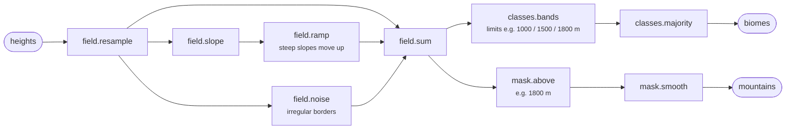
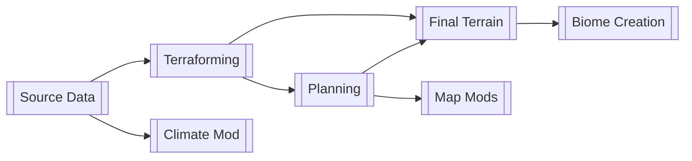
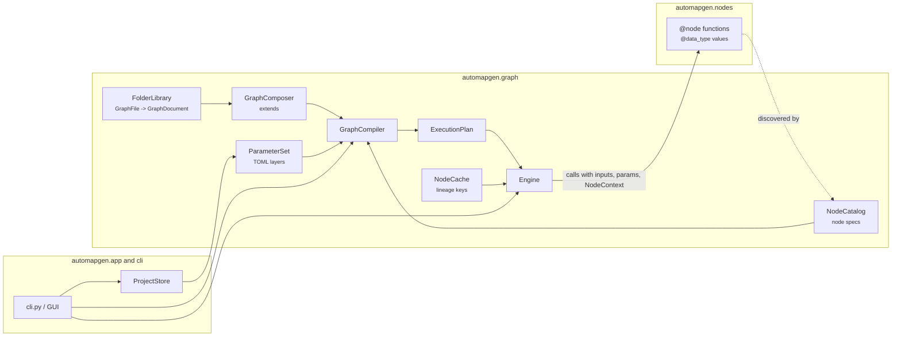

# Architecture

Why tf3-AutoMapGen is built as it is, what a graph is, and how the classes work together. The formats and the node API
are described in [node_guide.md](node_guide.md).

## 1. Principles

**Goal.** tf3-AutoMapGen turns open geodata into realistic Transport Fever 3 maps. Maps differ in many respects -
region, scale, look, which rivers are real water, how towns are placed - and the methods keep improving. The
architecture has to make both cheap: a new map needs no code, and a new method does not break the existing ones. The
project is open source (Apache-2.0), so others must be able to understand, change and extend it.

**Guiding idea:** *the logic (nodes) stays largely constant; data, parameters, composition and execution settings
adapt to the concrete map.* This leads to five concerns, each of which changes for its own reason:

| Concern | What | Changes when ... | Form |
|---|---|---|---|
| **Data** | immutable typed values flowing between nodes (a height field, a mask, a river plan, a node tree of the game) | a new kind of value is needed (rare) | classes + `@data_type` |
| **Parameters** | settings of nodes and graphs | values are tuned (often) | pydantic models in code, values in TOML parameter sets |
| **Processing** | nodes: pure functions inputs + parameters -> outputs | a new method is needed | `@node` functions in plugin packages |
| **Composition** | which nodes, how they are wired, which parameters are exposed | the behaviour is to change | JSON graph documents, `extends` |
| **Execution** | check, order, cache, memory, progress, cancel, previews | runtime needs change | the engine |

The paradigm is a **declarative, typed dataflow graph with plugin nodes** - the model of node-based tools such as
Houdini, Gaea/World Machine, Unreal PCG, Blender Geometry Nodes or ComfyUI, and of data pipelines such as Kedro and
Dagster. The game's own terrain generator is a node graph as well ([climate_mod.md](climate_mod.md)).

**Why this way:**

- **Reproducible and traceable.** Nodes are pure functions: the same inputs and parameters give the same result.
  This made it possible to take over the predecessor project step by step and to prove with comparison tests that
  every step produces byte-identical files.
- **Fast iteration.** Because a result depends only on inputs and parameters, it is cached under its lineage; after a
  change only the affected nodes run again. Changing a forest threshold does not recompute the rivers.
- **Errors before the run.** A graph is checked completely when it is loaded - types, links, parameters - and all
  problems are reported at once, each with its location.
- **Open for extension.** A new method is a new node; it affects no graph that does not use it. A new map variant is
  a graph that `extends` the standard graph and states only its differences.
- **Ready for a graph editor.** Graphs are plain data (JSON with a schema), so a visual editor can read and write them
  without knowing the code.

**Rules:**

1. **Nodes are pure.** No files, environment or globals; inputs are never changed. I/O only in nodes declared
   `side_effects=True` (sinks: write files, copy to the game; always run, never cached) and in source nodes (read
   data; cached by their parameters). Randomness only from a seed parameter.
2. **Nodes do not know each other.** They know data types only; dependencies exist only in the composition.
3. **Everything is typed and checked when a graph is loaded**, before anything runs.
4. **No loops or conditions in graphs.** Variants are other subgraphs or parameters; iteration over collections (e.g.
   per town) happens inside a node. Graph documents stay data, not a programming language.
5. **Changing behaviour = changing composition or parameters.** Code only for a new node or data type.
6. **Composition in layers, not copies.** A map graph `extends` a standard graph, so improvements of the standard
   reach every map.
7. **Stable contracts, versioned changes.** A node's ports and meaning are its contract; incompatible parameter
   changes raise the node version and come with a migration, so saved graphs keep working.
8. **The framework knows no domain.** `automapgen.graph` knows nothing about maps or games; node packages use only its
   public API (checked by `tests/unit/test_architecture.py`). Outside the nodes the code is object-oriented: single
   responsibility, dependencies injected, extension via registries and strategies, no global mutable state.

## 2. What a graph is and what it does

A **node** is a small function with typed inputs, typed outputs and parameters. `mask.below` takes a `field` (e.g.
heights) and returns a `mask` of the pixels below its parameter `limit`. Its signature is its contract:

```python
@node("mask.below", output="mask")
def below(value: Field, params: BelowParams, context: NodeContext) -> Mask:
    """Pixels whose value is below the limit."""
```

A **graph** wires nodes: each link connects an output to an input of the same type. A graph can have inputs and
outputs of its own and is then usable as one node in another graph (a **subgraph**). A small example - the built-in
graph `biomes`, the game's biomes 1-4 from the heights:



The graph *document* only says which nodes exist, how they are linked and which parameters are exposed; the values
come from **parameter sets** (TOML), layered like style sheets: the climate preset, a landscape on top of it, the
project on top of that. So the same graph serves every map, and a project file holds only what is special about its
map.

The built-in map graph `map` follows the way a person would build a map. Its top level has seven groups, each a
graph of its own with a title and a description of what it does, where and how:



*Source Data* reads the elevation model, WorldCover, OpenStreetMap and the game's files onto the map frame;
*Terraforming* computes height references, biomes, rivers and a draft terrain; *Planning* places paths, roads, towns
and industries on the draft; *Final Terrain* evens out the terrain around them and writes the heightmap; *Biome
Creation* writes the biome map and the import layers; *Climate Mod* and *Map Mods* build the mods. Terraforming and
Planning contain further groups (elevation, biomes, rivers and water, draft terrain; paths and roads, towns,
industries). In total the map has about 190 nodes. The step-by-step walk through a real map is in
[example.md](example.md), the diagrams of all built-in graphs in [graphs/](graphs/); the GUI shows them with "Show
graph".

When a graph runs, the engine

1. **compiles** it: resolves `extends`, dissolves subgraphs into one flat plan, merges and validates the parameters,
   checks every link and orders the nodes;
2. computes a **lineage key** for every output before anything runs: a hash of the node type, its version and code,
   its parameters and the keys of its inputs;
3. runs only what is needed, takes unchanged results from the **cache**, drops values from memory after their last
   consumer, reports progress and can be cancelled between and inside nodes.

## 3. How the classes work together



- **Nodes and data types** (`automapgen.nodes`) are plain functions and frozen classes, marked with `@node` and
  `@data_type`. They import only the public API of `automapgen.graph`.
- **`NodeCatalog`** collects them from the built-in modules and from plugins (entry point group `automapgen.nodes`) and
  reads each function's signature into a `NodeSpec`: ports, parameter schema (a pydantic `NodeParams` model), version.
- **`GraphFile` / `GraphDocument`** load a JSON graph document into a validated model; **`FolderLibrary`** finds
  graphs by id (a project's own folder before the built-in graphs); **`GraphComposer`** resolves `extends`.
- **`ParameterSet`** loads the TOML layers (preset -> landscape -> project; each file names the ones below it with
  `extends`) and merges them key by key.
- **`GraphCompiler`** joins the three - document, parameters, catalog - into an **`ExecutionPlan`**: flat, typed,
  ordered, every parameter validated. All problems end in one `GraphError`.
- **`Engine`** executes the plan: computes the lineage keys, asks the **`NodeCache`** (memory or disk), calls the node
  functions with their inputs, parameters and a **`NodeContext`** (log, progress, cancellation, and the run settings:
  output folder, download folder, game folder, secrets), notifies a `RunListener` and writes previews on request.
- **The application** (`automapgen.app`, `cli.py`) knows projects (`ProjectStore`: `configs/projects/<id>.toml`),
  local settings (`local/settings.toml`: game folder, user data folder, API keys) and the user interfaces. The CLI and
  the browser GUI both compile and run graphs through the same classes; the GUI's "advanced settings" are generated
  from the parameter schemas in the plan, so a new node parameter appears there without GUI code (ADR 0010).

The dependencies point one way: application -> nodes -> framework. The framework could serve another game.
